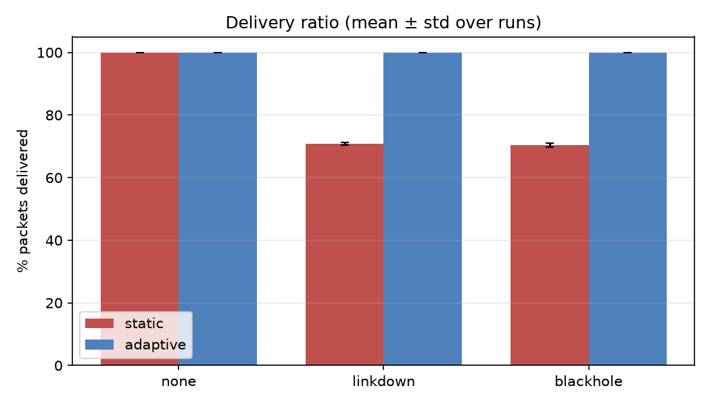
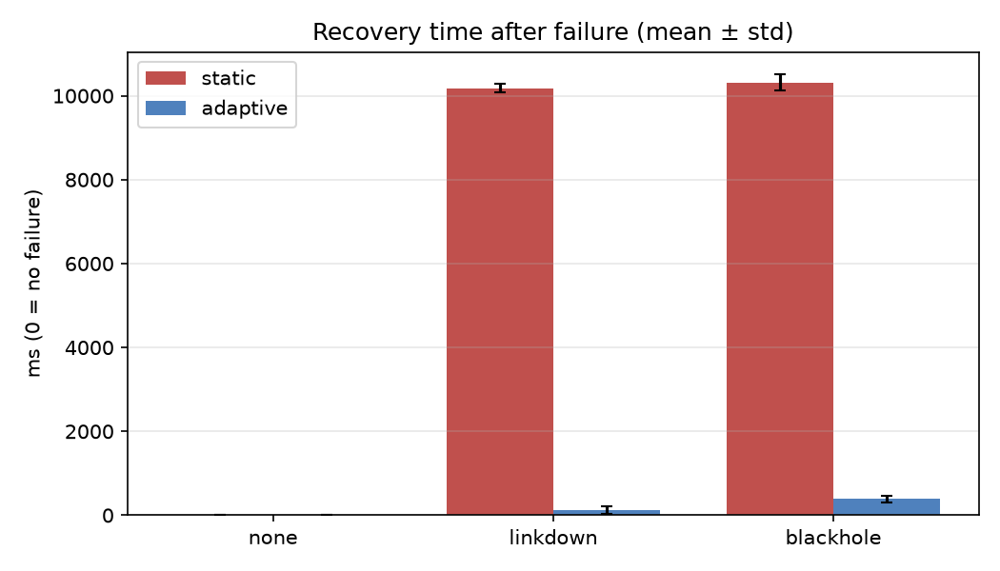
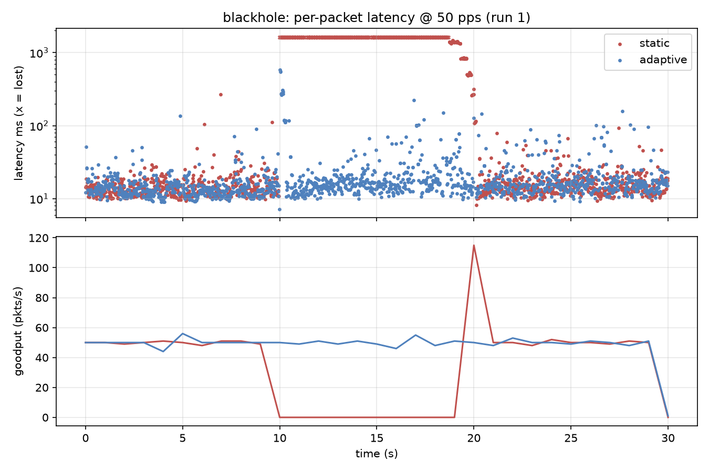
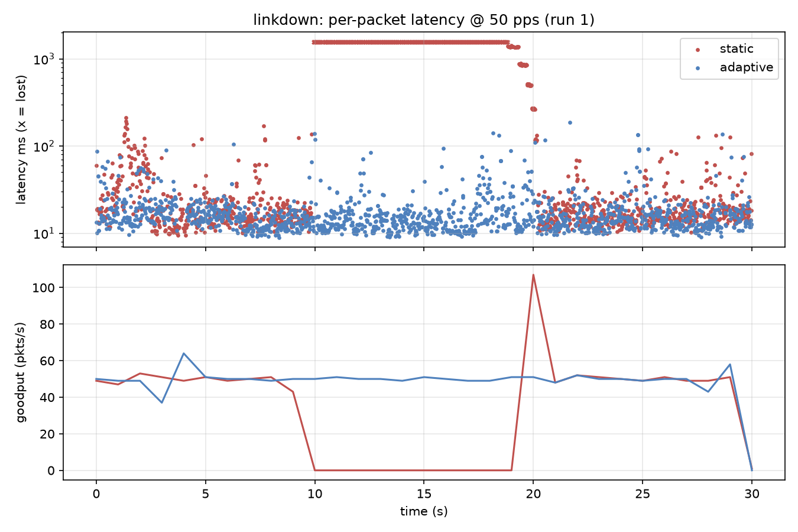

# Project 30 – Adaptive Communication Network with Failure Recovery (UDP + SDN)

> 📄 **Project Report:** [docs/Project30_Report.pdf](docs/Project30_Report.pdf)  
> **Team 4:** Podili Sethu Sriram (PES1UG25AM555), Suryakoti Sunil Salunke (PES1UG25AM529), Vishal Sharanabasappa Dindi (PES1UG26AM823)

A UDP application (client on h1, server on h2) runs over a Mininet network with two
disjoint paths. An OS-Ken (OpenFlow 1.3) controller steers traffic over path A, detects
failures, and reroutes to path B. The application has its own recovery logic and **tells the
controller** when it suspects a dead path, so the two layers cooperate.

```
            +---- s2 ----+            Path A (preferred): h1 - s1 - s2 - s4 - h2
    h1 - s1               s4 - h2     Path B (backup)   : h1 - s1 - s3 - s4 - h2
            +---- s3 ----+            links: 10 Mbit/s, 2 ms delay
```

## 1. Architecture and communication flow

| Component | File | Role |
|---|---|---|
| Protocol | `protocol.py` | 18-byte binary header: magic, type (DATA/ACK/FIN/FINACK), attempt, client_id, seq, timestamp |
| UDP server (h2) | `server.py` | Receiver thread + worker pool; ACKs every DATA; per-client stats; many clients at once |
| UDP client (h1) | `client.py` | Fixed-rate sender; ACK/timeout/retransmit with exponential backoff; outage detection; notifies controller |
| Controller | `controller.py` | Path A/B flows, link-event handling, application-report handling, flow-stats polling, `static` baseline mode |
| Topology | `topology.py` | Mininet topology (4 OVS switches, OpenFlow 1.3, `TCLink`) |
| Experiments | `experiment.py`, `run_all.sh`, `analyze.py` | Automated failure scenarios, tables and charts |
| Tests | `tests/` | Mininet-free tests of the UDP app and the controller decision logic |

**Socket ↔ SDN integration (two directions)**
* *Network → application*: the controller rewrites flows; the client sees ACKs resume. 
* *Application → network*: after `--suspect-after` (default 3) consecutive timeouts the client sends a
  JSON `PATH_SUSPECT` datagram to the controller over a **UNIX datagram socket**
  (`/tmp/p30_controller.sock`; hosts have separate network namespaces but share the filesystem).
  The controller treats the active path as suspect for `P30_SUSPECT_HOLD` seconds and reroutes.
  This is what recovers *silent* failures (100 % loss with the interface still UP), which never
  produce a port-status/link event. `RECOVERED` is reported when ACKs return.
  Reports carry `since` (send time of the newest timed-out packet); the controller ignores reports
  older than its last path change, so a stale report can't condemn the new path.

**Dynamic SDN functionality**
* Hard failure: `EventLinkDelete` → mark link down → `install(B)`; `EventLinkAdd` → back to A.
* Gray failure: application report → mark path suspect → `install(B)`; hold-down expiry or link-up → retry A.
* Make-before-break reroute: new-path flows are written middle-switch first, then edge switches
  (identical match ⇒ `OFPFC_ADD` replaces in place); only our own flows (cookie `0x30`) are deleted
  from switches the new path no longer uses. The table-miss rule is never removed.
* Failures of the unused backup path don't disturb traffic; double failures are handled (`NO_PATH_AVAILABLE`).
* Flow-stats polling logs per-switch match counters so the demo shows which path carries traffic.

**Application-level recovery**: ACK per datagram, RTO 100 ms × 1.5^attempt, 5 retries, then the packet
is declared lost; duplicate/late ACKs and malformed datagrams are ignored; server de-duplicates retransmits.

## 2. Setup (Ubuntu, Python ≥ 3.8)

```bash
sudo apt install mininet openvswitch-switch
python3 -m venv venv && source venv/bin/activate     # the controller needs the venv (os-ken)
pip install -r requirements.txt
chmod +x run_all.sh                                    # needed after unzipping
./run_tests.sh                                         # Mininet-free checks, about 20 s
```

If `./run_all.sh` says *Permission denied* run the `chmod`; if the controller says
*No module named os_ken* the venv is not active.

## 3. Run the demo manually (3 terminals)

```bash
# T1 – controller (adaptive)                       # baseline: P30_MODE=static
python3 run_controller.py controller.py --port 6653
# T2 – topology
sudo python3 topology.py
# T3 – inside the mininet> prompt
mininet> h1 ping -c 3 h2
mininet> h2 python3 server.py &
mininet> h1 python3 client.py --duration 40 --out-prefix /tmp/demo &
mininet> sh ovs-ofctl -O OpenFlow13 dump-flows s2        # path A: s2 has flows
mininet> link s1 s2 down                                  # controller log: LINK_DOWN, PATH_INSTALLED B
mininet> sh ovs-ofctl -O OpenFlow13 dump-flows s3        # s3 now has flows, s2 flows removed
mininet> link s1 s2 up                                    # LINK_UP, PATH_INSTALLED A
```
Silent failure demo: `mininet> sh tc qdisc replace dev s1-eth2 root netem loss 100%` (and `s2-eth1`)
– the interface stays up, yet the controller log shows `APP_REPORT … PATH_SUSPECTED … PATH_INSTALLED B`.

## 4. Reproduce the evaluation

```bash
./run_all.sh            # 2 modes x 3 scenarios x 3 rates x 5 repetitions = 90 runs (~70 min); QUICK=1: 50 pps only (~25 min)
                        # REPS=2 for fewer repeats; START_REP=3 REPS=5 to resume
python3 analyze.py      # -> results/runs.csv, summary.md (mean ± std), comparison.md, *.png
```

| Dimension | Values |
|---|---|
| Approach | **static** baseline (path A only, never reacts) vs **adaptive** (this project) |
| Scenario | `none`, `linkdown` (s1–s2 down 10 s…20 s), `blackhole` (100 % loss on s1–s2) |
| Load | 20 / 50 / 100 packets/s, 64-byte payload, 30 s |
| Metrics | delivery ratio, packets lost, retransmissions, mean/p95/p99/max latency, **recovery time** (failure timestamp -> first later packet ACKed on its first attempt that is followed within 0.5 s by first-attempt successes for at least 80 % of the packets, see `analyze.py`), service interruption (longest ACK gap; reference only), goodput, controller reaction (`results/*_controller.jsonl`) |

### Test cases

| # | Test | Expected |
|---|---|---|
| T1 | `h1 ping h2` with controller up | 0 % loss over path A |
| T2 | UDP stream, no failure | 100 % delivery, 0 retransmissions, flow-stats grow on s2 only |
| T3 | `link s1 s2 down` | `LINK_DOWN` → `PATH_INSTALLED B`; stream resumes (adaptive); stalls until link-up (static) |
| T4 | `link s1 s2 up` | `LINK_UP` → `PATH_INSTALLED A` |
| T5 | Silent 100 % loss on s1–s2 | adaptive: `PATH_SUSPECTED` + reroute within ~hundreds of ms; static: stalls |
| T6 | Fail s3–s4 while on A | no reroute, no packet disturbance |
| T7 | Three concurrent clients (`sudo python3 demo_t7.py [--fail]`, see below) | all served concurrently, per-client stats on server |
| T8 | Both paths down | `NO_PATH_AVAILABLE`, no crash; recovery when a link returns |

Mininet-free tests (run anywhere): `./run_tests.sh` (runs `tests/test_loopback.py` and
`tests/test_controller_logic.py`).

### T7 – three concurrent clients

Start the controller in one terminal (`python3 run_controller.py controller.py --port 6653`), then:

```bash
sudo /usr/bin/python3 demo_t7.py            # 3 clients x 20 pps x 30 s, no failure
sudo /usr/bin/python3 demo_t7.py --fail     # link s1-s2 goes down at t = 10 s and up again 5 s later
cp /tmp/t7_summary.txt results/t7_failure_summary.txt     # keep the output as evidence
```

`demo_t7.py` builds the topology, starts the server on h2, launches the clients on h1 back-to-back, optionally
fails the link, and prints per-client sent/delivered/lost, the server's unique and duplicate counts, a concurrency
check (first and last packets of all clients within the same second) and the controller events of the run.
Measured result (VirtualBox VM): every client delivered all 600 packets with 0 lost, with and without the failure;
in the failure run the controller logged `LINK_DOWN` and `PATH_INSTALLED B` at 10.1 s, `LINK_UP` and
`PATH_INSTALLED A` at 15.5 s, and the server saw one duplicate datagram per client (a retransmission).
Screenshot: `docs/screenshots/20_t7_three_clients_link_failure.png`.

## 5. Results and evidence

### 5.1 Experimental setup
Two-path Mininet topology (10 Mbit/s, 2 ms links), OpenFlow 1.3 controller (OS-Ken), UDP client/server with ACK + retransmission (RTO 100 ms x1.5 backoff, 5 retries). Each configuration was run **5 times** (90 runs in total) for loads of 20, 50, 100 packets/s; a run lasts 30 s with the failure injected at t = 10 s and removed at t = 20 s on link s1-s2 (path A). **Baseline** = static mode (controller installs path A once and never reacts). **Adaptive** = this project (link-event detection + application reports). Values are mean ± standard deviation over runs.

Scenarios: `none` (no failure), `linkdown` (interface down, generates link events), `blackhole` (100 % loss, interface stays up: **no** link event, only the application can notice).

Metrics: delivery ratio, retransmissions, p95 delivery latency (first send -> ACK), **recovery time** (failure -> first packet of a sustained first-attempt-ACKed run, see `analyze.py`), longest ACK gap, goodput.

### 5.2 Adaptive vs static (all loads pooled)

| Scenario | Metric | Adaptive | Static |
|---|---|---|---|
| none | delivery (%) | 100.0 ± 0.0 | 100.0 ± 0.0 |
| none | p95 latency (ms) | 50 ± 18 | 48 ± 12 |
| none | retransmissions / run | 22 ± 38 | 11 ± 16 |
| linkdown | delivery (%) | 100.0 ± 0.0 | 70.8 ± 0.5 |
| linkdown | recovery time (ms) | 124 ± 94 | 10174 ± 102 |
| linkdown | p95 latency (ms) | 42 ± 13 | 502 ± 91 |
| linkdown | retransmissions / run | 17 ± 29 | 2803 ± 1698 |
| blackhole | delivery (%) | 100.0 ± 0.0 | 70.4 ± 0.6 |
| blackhole | recovery time (ms) | 390 ± 83 | 10320 ± 201 |
| blackhole | p95 latency (ms) | 54 ± 18 | 457 ± 76 |
| blackhole | retransmissions / run | 47 ± 43 | 2808 ± 1693 |

### 5.3 Results per load

| Scenario | pps | Mode | Delivery % | Lost | Retrans. | p95 lat (ms) | Recovery (ms) | Longest ACK gap (ms) |
|---|---|---|---|---|---|---|---|---|
| blackhole | 20 | adaptive | 100.0 ± 0.0 | 0 ± 0 | 11 ± 4 | 49 ± 11 | 398 ± 93 | 301 ± 52 |
| blackhole | 20 | static | 70.2 ± 0.8 | 179 ± 5 | 995 ± 24 | 419 ± 116 | 10421 ± 289 | 10250 ± 246 |
| blackhole | 50 | adaptive | 100.0 ± 0.0 | 0 ± 0 | 36 ± 13 | 48 ± 12 | 426 ± 82 | 329 ± 77 |
| blackhole | 50 | static | 70.5 ± 0.5 | 443 ± 7 | 2471 ± 32 | 465 ± 60 | 10278 ± 134 | 10210 ± 145 |
| blackhole | 100 | adaptive | 100.0 ± 0.0 | 0 ± 0 | 94 ± 43 | 64 ± 26 | 345 ± 66 | 384 ± 107 |
| blackhole | 100 | static | 70.5 ± 0.4 | 885 ± 11 | 4958 ± 85 | 488 ± 3 | 10260 ± 142 | 10179 ± 107 |
| linkdown | 20 | adaptive | 100.0 ± 0.0 | 0 ± 0 | 6 ± 6 | 41 ± 9 | 144 ± 108 | 222 ± 154 |
| linkdown | 20 | static | 71.1 ± 0.5 | 173 ± 3 | 974 ± 9 | 517 ± 169 | 10132 ± 38 | 10096 ± 64 |
| linkdown | 50 | adaptive | 100.0 ± 0.0 | 0 ± 0 | 10 ± 7 | 38 ± 9 | 109 ± 68 | 215 ± 169 |
| linkdown | 50 | static | 70.8 ± 0.5 | 438 ± 7 | 2483 ± 58 | 496 ± 6 | 10141 ± 73 | 10113 ± 66 |
| linkdown | 100 | adaptive | 100.0 ± 0.0 | 0 ± 0 | 34 ± 48 | 48 ± 19 | 118 ± 116 | 138 ± 94 |
| linkdown | 100 | static | 70.5 ± 0.4 | 885 ± 11 | 4952 ± 71 | 493 ± 4 | 10249 ± 138 | 10228 ± 136 |
| none | 20 | adaptive | 100.0 ± 0.0 | 0 ± 0 | 4 ± 4 | 40 ± 12 | n/a | 158 ± 107 |
| none | 20 | static | 100.0 ± 0.0 | 0 ± 0 | 3 ± 2 | 46 ± 8 | n/a | 128 ± 64 |
| none | 50 | adaptive | 100.0 ± 0.0 | 0 ± 0 | 13 ± 16 | 51 ± 10 | n/a | 246 ± 228 |
| none | 50 | static | 100.0 ± 0.0 | 0 ± 0 | 7 ± 6 | 46 ± 14 | n/a | 152 ± 111 |
| none | 100 | adaptive | 100.0 ± 0.0 | 0 ± 0 | 50 ± 57 | 59 ± 25 | n/a | 226 ± 151 |
| none | 100 | static | 100.0 ± 0.0 | 0 ± 0 | 24 ± 23 | 52 ± 14 | n/a | 214 ± 184 |

Charts: `results/delivery_ratio.png`, `recovery_time.png`, `recovery_vs_rate.png`, `latency_p95.png`, `interruption.png`, `timeline_linkdown.png`, `timeline_blackhole.png`.






### 5.4 Findings

1. **Hard failure (link down).** Adaptive delivered 100.0 % of packets versus 70.8 % for static and recovered in 124 ms versus 10174 ms (about 82x faster). Static only works again when the failure itself ends; adaptive restores service on the backup path while the failure is still present.
2. **Silent failure (black-hole).** Adaptive delivered 100.0 % of packets versus 70.4 % for static and recovered in 390 ms versus 10320 ms (about 26x faster). Static only works again when the failure itself ends; adaptive restores service on the backup path while the failure is still present.
3. **Detection path matters.** Link events recover in 124 ms; application reports need 390 ms (about 266 ms more) because the client first needs consecutive timeouts plus 250 ms of silence before it reports. This is the price of detecting failures that OpenFlow cannot see.
4. **No cost in normal operation.** Without failures both modes deliver the same share of packets (difference +0.00 percentage points); differences in latency and retransmissions are within VM jitter.
5. **Cost of application-level recovery grows with load.** In the black-hole case adaptive needs on average 11 retransmissions at 20 pps, 36 retransmissions at 50 pps, 94 retransmissions at 100 pps; static needs 995 to 4958 and still loses about 30 % of the packets.

### 5.5 Limits and design trade-offs

* The application can mask an outage only up to about RTO x retries (about 1.4 s); longer outages need the controller to reroute first, which is exactly what the application report triggers.
* After a silent failure there is no link-up event, so the controller returns to path A only when the 20 s hold-down (`P30_SUSPECT_HOLD`) expires: a short hold-down returns sooner but risks flapping, a long one keeps traffic on the backup path longer.
* If every usable path is suspect, the controller rotates to the other path on each fresh report instead of sticking with the preferred one (found and fixed during testing).
* Only one failure at a time on the s1-s2 link was evaluated; two simultaneous failures are covered by the logic tests (`NO_PATH_AVAILABLE`) but were not measured.
* Results come from one VirtualBox VM; scheduling jitter adds noise (visible in the `none` rows). Absolute numbers will differ on other machines; the relative comparison is the result.

### 5.6 Data-quality notes

* One run (`adaptive_linkdown_50pps_r3`) was discarded and repeated: its maximum latency (about 11 s) is impossible with a 1.4 s retry window, so the client process/VM had been stalled; the original files are kept in `results/discarded/`. The controller log of that run shows a normal reroute.
* The recovery metric requires a *sustained* first-attempt recovery: in an earlier version, packets that slipped through while `tc` was being reconfigured made 3 of 15 static black-hole runs look recovered after under 130 ms although their ACK gap (about 10 s) and delivery (about 70 %) show they did not. The metric was corrected and all runs re-analysed from the saved per-packet logs; no experiment was repeated for this reason.
* In 3 of the 15 adaptive no-failure runs (`adaptive_none_20pps_r2`, `adaptive_none_50pps_r3`, `adaptive_none_100pps_r3`) a client report, sent although nothing had failed, moved the traffic to path B; delivery stayed at 100 %. All 30 adaptive failure runs were checked and none had an early reroute. Re-check with `python3 check_startup_reroutes.py`.


## 6. Test and validation checklist

```bash
./run_tests.sh          # syntax check + controller logic + loopback tests
python3 check_startup_reroutes.py   # spurious / early reroutes in the saved results
```

For silent-loss validation, confirm `APP_REPORT report=PATH_SUSPECT`, `PATH_SUSPECTED path=A`, and `PATH_INSTALLED path=B` in the controller log. If only the first appears, inspect `APP_REPORT_STALE`; if no report appears, verify both processes use the same `P30_SOCK`. Static mode is intentionally a non-reactive baseline.

## 7. Troubleshooting
* `h1 cannot reach h2`: controller not running, wrong port (`--ofp-tcp-listen-port 6653` must match
  `--controller-port`), or started without `--observe-links`.
* Stale state: `sudo mn -c`. Re-run controller per experiment (`run_all.sh` does this).
* Hosts can't use the UNIX socket: it needs `/tmp` shared (default Mininet).
* `bash: ./run_all.sh: Permission denied` -> `chmod +x run_all.sh`. `ModuleNotFoundError: os_ken` -> `source venv/bin/activate`.
* The controller log must exist before you `tail` it: start a run first (`results/<run>_controller.log`).

## 8. Repository layout

| Path | Purpose |
|---|---|
| `protocol.py`, `server.py`, `client.py` | UDP application: 18-byte header, ACK server with worker pool, client with retransmission and controller reports |
| `controller.py`, `run_controller.py` | OS-Ken OpenFlow 1.3 controller (adaptive and static mode); launcher for OS-Ken 4.2.2 |
| `topology.py` | Mininet topology: h1, h2 and s1-s4, two disjoint paths |
| `experiment.py`, `run_all.sh` | One automated run / the full 90-run sweep |
| `analyze.py`, `make_report.py` | Tables, charts and the README results section from `results/` |
| `demo_t7.py` | T7: three concurrent clients, optional link failure |
| `check_startup_reroutes.py` | Finds early or spurious application-report reroutes in the saved logs |
| `run_tests.sh`, `tests/` | Mininet-free tests |
| `results/` | Raw per-run data, controller logs, tables, charts (`discarded/` = the repeated run) |
| `docs/` | Project report (PDF) and the screenshots used in it |
| `CHANGES.md`, `RESULTS.md` | Problems found and fixed; generated results section |
